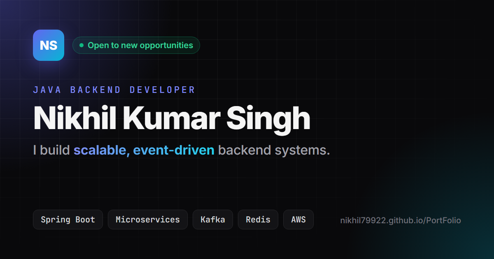

# Nikhil Kumar Singh — Portfolio

Personal portfolio of a Java Backend Developer (Spring Boot · Microservices · Kafka · Redis · AWS).

**Live:** https://nikhil79922.github.io/PortFolio/



## Stack

- React 18 + TypeScript, built with Vite 7
- Tailwind CSS with shadcn/ui primitives (Radix UI)
- Light / Dark / System theme, responsive layout, keyboard and screen-reader friendly
- Zero third-party requests at runtime: fonts and logos are self-hosted
- Strict Content-Security-Policy injected at build time (see `vite.config.ts`)

## Edit the content

Everything shown on the site lives in **`src/lib/DynamicValues.ts`** — profile, stats,
experience, projects, skills, achievements and links.

- **Résumé:** put a PDF (with phone number / address removed) at `src/assets/resume.pdf`.
  It is picked up automatically and served from the site; otherwise the Google Drive link is used.
- **Logos:** add an SVG to `src/assets/logos/` and reference it with `logo("name")`.
- Use direct `https://` links only — no URL shorteners.

## Develop

Requires Node.js 20.19+.

```bash
npm ci            # install exact locked dependencies
npm run dev       # http://localhost:3000/PortFolio/
npm run check     # lint + typecheck + production build
npm run preview   # serve the production build locally
```

## Deploy to GitHub Pages

```bash
git add -A
git commit -m "Update portfolio"
git push origin master
npm run deploy
```

`npm run deploy` refuses to run with uncommitted changes, so the live site always matches
a commit on GitHub. It then lints, typechecks, builds and publishes `dist/` to the
`gh-pages` branch. In the repository settings, **Pages → Source** must be
*Deploy from a branch* → `gh-pages` / `(root)`.

## License

Code: MIT (see [LICENSE](LICENSE)). Personal content is not covered by the license.
Originally based on a template by [p32929](https://github.com/p32929).
